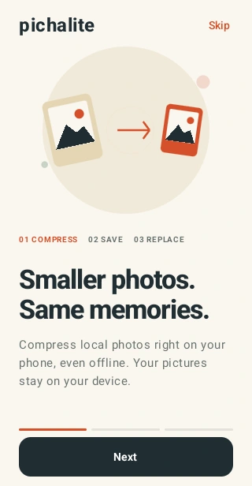
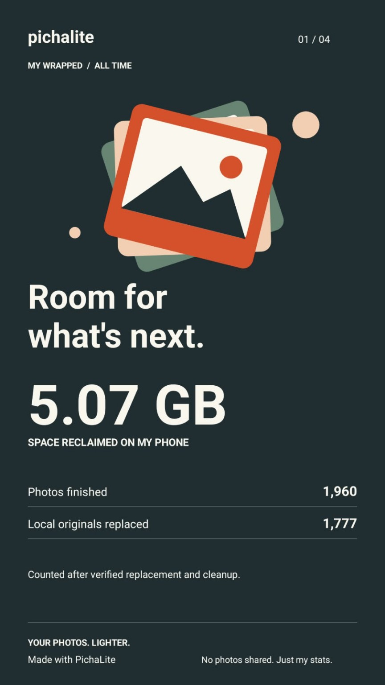

# PichaLite for VS Code

**Your photos. Lighter. Right inside your editor.**

Compress project images locally with the same Rust encoder behind [PichaLite](https://pichalite.co.ke/). No uploads or runtime downloads.



*Artwork from the PichaLite website, showing the Android app. The VS Code extension uses the Explorer menu, native pickers and progress notifications described below.*

## Compress in three steps

1. Select images or a folder in Explorer and right-click **PichaLite: Compress Images**.
2. Choose the destination and confirm quality and size settings.
3. Keep working while PichaLite saves copies in a `PichaLite` subfolder.


Right-click a local image, multiple images or a folder in Explorer and choose **PichaLite: Compress Images**. The Command Palette offers the same command with file/folder selection.

Choose a destination. Copies are written to its `PichaLite` subfolder. Confirm the batch, then follow progress in VS Code. Cancel stops after the current image; completed copies remain saved. Results and failures are available in the PichaLite output panel.

- JPEG, PNG and WebP input; JPEG output. Transparent pixels become white.
- Quality 40–95 (default 82); maximum edge 256–40000 (default 4096).
- Up to 5,000 photos, 40 MB per photo; native decoder memory limit applies.
- Originals are never replaced. Larger results preserve an exact original copy with its original extension. Existing outputs are never overwritten.
- Images are processed locally. No uploads, runtime downloads or analytics.
- The `win32-x64` VSIX bundles `pichalite-cli.exe`. Other hosts need a matching native CLI and an absolute `pichalite.executablePath` machine setting. Remote extension hosts use the remote operating system.
- Requires a trusted, local-filesystem workspace. Symlinks, `.git`, `node_modules` and the current output folder are skipped.

## Install

Available for **Windows x64**. Search for **PichaLite** by **masota** in Extensions, or run:

```sh
code --install-extension masota.pichalite
```

The Windows native encoder is included. Rust is not required. This extension shares the encoder; Android's Rivium/Apalis durable background queue is not included.

## From the PichaLite website



*An example from the Android app, not an extension benchmark or a promised compression result. Actual savings depend on your files.*

## Development

Build `../native` with `cargo build --release --manifest-path ../native/Cargo.toml`, copy the Windows `pichalite-cli.exe` to `bin/`, then `npm ci && npm test && npm run package`. Packaging on CI performs these steps. `bin/` is populated at build time; no executable is downloaded when the extension runs.
